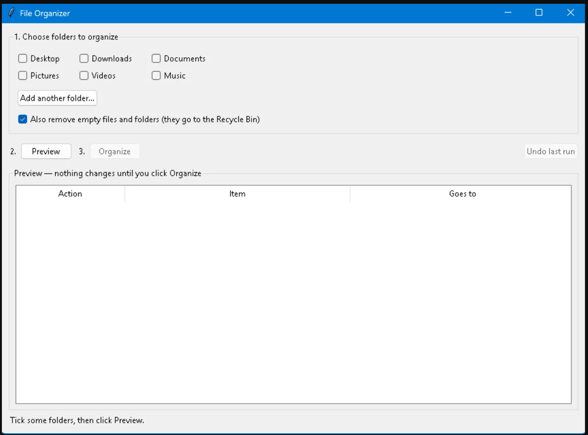
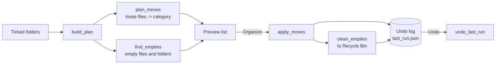

# File Organizer

A Windows desktop app that tidies your personal folders. It sorts loose files
into category folders (Images, Documents, Audio…), sends empty files and
folders to the Recycle Bin, shows you a full preview before changing anything,
and can undo the last run with one click.

It's built to be **safe on a real PC**: it never overwrites, never permanently
deletes, and refuses to touch system folders or code projects.



## Features

- **Pick your folders**: Desktop, Downloads, Documents, Pictures, Videos and Music are detected automatically, and you can add any other folder
- **Preview first**: every planned move and removal is listed; nothing changes until you click Organize
- **Sorts by file type** into 8 categories, defined in [`rules.json`](rules.json) (easy to edit)
- **Removes empty files and folders** (optional), to the Recycle Bin, never a permanent delete
- **One-click undo** for the whole last run: moved files go back and removed empties are recreated
- **Single `.exe`**: no Python needed to run it

## Safety rules

| Rule | How it's enforced |
|---|---|
| Never overwrite a file | Name clashes get ` (1)`, ` (2)`…; destinations are re-checked right before each move |
| Never permanently delete | Removal uses the Recycle Bin (`send2trash`) |
| Don't break code projects | Folders containing `.git`, `package.json`, `requirements.txt`, `.venv` etc. are skipped entirely |
| Don't touch system or app folders | Drive roots, your whole user folder, `Windows`, `Program Files`, `ProgramData` and `AppData` are refused |
| Leave your own folders alone | Only loose files are sorted; existing folders are never moved |
| Keep shortcuts and system files | `.lnk`, `.url`, `desktop.ini`, hidden and system files are skipped |
| Don't mistake cloud files for empty ones | OneDrive "online-only" placeholders and links are never removed |
| Keep intentional empty files | `__init__.py`, `.gitkeep`, `.nojekyll` are kept |
| Partial failures are safe | A file open in another app is skipped and reported; the rest continue, and the undo log is always written |

## Tech stack

- Python 3.11+
- Tkinter (built into Python) for the window
- `send2trash` for Recycle Bin support
- pytest for tests
- PyInstaller to build the `.exe`

## Project structure

```
file-organizer/
  app.py            # the window: checkboxes, preview list, buttons (no logic)
  organizer.py      # all the logic: plan, move, clean empties, undo
  rules.json        # category -> file extensions
  tests/            # 43 tests, all run on temporary folders
  docs/screenshots/
  requirements.txt
  LICENSE
```

## How it works



1. **Plan**: for each ticked folder, `plan_moves()` matches each loose file's extension against `rules.json`, and `find_empties()` walks the folder bottom-up to find empty items. Nothing on disk changes.
2. **Preview**: the plan is shown in the window.
3. **Organize**: `apply_moves()` moves the files, then `clean_empties()` sends empties to the Recycle Bin. Every action is recorded in an undo log at `%LOCALAPPDATA%\FileOrganizer\last_run.json`.
4. **Undo**: `undo_last_run()` replays the log in reverse. It recreates empties, moves files back (only if the original spot is free), then removes category folders it created, but only if they're empty again.

`organizer.py` has no UI code, so all of this is tested without a window.

## Setup

### Just use it
Download `FileOrganizer.exe` from the [Releases](../../releases) page and double-click it.

> Windows SmartScreen may warn that the app is unrecognised, because it isn't code-signed. Click **More info**, then **Run anyway**.

### Run from source (PowerShell)
```powershell
git clone https://github.com/ivanedens55-web/file-organizer.git
cd file-organizer
python -m venv .venv
.\.venv\Scripts\Activate.ps1
pip install -r requirements.txt
python app.py
```

Run the tests:
```powershell
pytest
```

Build the `.exe`:
```powershell
pip install pyinstaller
pyinstaller --onefile --windowed --name FileOrganizer --add-data "rules.json;." app.py
```

No API keys or environment variables are needed.

### Try it safely first
Point it at a test folder full of dummy files before using it on real folders:
```powershell
mkdir C:\OrganizerTest; cd C:\OrganizerTest
"x" > photo.jpg; "x" > report.pdf; New-Item empty.txt; mkdir "New folder"
```
Then use **Add another folder…** to pick `C:\OrganizerTest`.

## Limitations

- **Windows only** for real use (logic and tests run anywhere; the Recycle Bin and folder detection are Windows-focused)
- **Top level only**: files already inside subfolders aren't sorted
- **One undo**: only the most recent run can be undone
- **Undo recreates empties rather than restoring them** from the Recycle Bin (they had no content, so nothing is lost; the originals also stay in the Recycle Bin)
- Unknown file types are left where they are
- Folders redirected to OneDrive, or moved elsewhere, aren't auto-detected; add them with **Add another folder…**
- Large folders may make the window pause briefly while scanning
- Tested manually on Windows 11; the `.exe` isn't code-signed

## Future improvements

- AI suggestions (Google Gemini) for files with unknown types, from the filename only, with user approval
- Sort by date (e.g. `Images/2026-10`) as an option
- Edit categories inside the app
- Scheduled automatic runs
- Undo history for more than one run
- Background scanning so the window never pauses

## License

MIT, see [LICENSE](LICENSE).